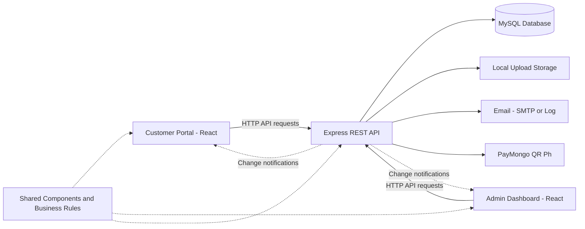

# Tres Marias Catering Services Web System

The local premium experience adds package comparison, a four-stage planning guide, curated review cards, customer event milestones, admin attention queues, financial comparisons, workspace search, and sortable tables. Both portals share typography, form feedback, upload progress, and dialog protection. Administrator access remains limited to the existing admin account.

Bookings, quotations, payments, notes, inventory and activity continue to use the existing API and database. Optional public gallery story details can be supplied in `apps/client/src/content/eventStories.js`; omitted event facts stay hidden.

Run `npm run test:experience` for upload, financial, search and contrast regression tests. `npm run test:premium-ui` checks the running customer and admin applications using isolated sessions and intercepted API fixtures, without database writes. It requires Playwright and Chrome; when Playwright is supplied by a separate runtime, set `PLAYWRIGHT_MODULE_PATH` to its absolute module directory. Optional `UI_CLIENT_URL`, `UI_ADMIN_URL` and `UI_OUTPUT_DIR` select the local servers and screenshot/report destination.

**System version: 1.29.2**


A web-based catering reservation and management system with a **Customer Portal**, an **Admin Dashboard**, and a shared **Express + MySQL API**. Customers can explore services, request event bookings, review quotations, track payments, and communicate with the business. Administrators manage reservations, schedules, packages, equipment, customer records, outsourcing, and reports.

The project keeps the two React applications in one npm workspace repository. Each portal can be built and deployed separately, while both use the same components, service layer, and business rules from `@tm/shared`.

## Table of Contents

- [Project Overview](#project-overview)
- [Objectives](#objectives)
- [Features](#features)
- [Booking Workflow](#booking-workflow)
- [Technology Stack](#technology-stack)
- [System Architecture](#system-architecture)
- [Requirements](#requirements)
- [Installation and Setup](#installation-and-setup)
- [How to Use](#how-to-use)
- [Screenshots and Demo](#screenshots-and-demo)
- [Project Structure](#project-structure)
- [Development Commands](#development-commands)
- [Database Maintenance](#database-maintenance)
- [Integrations and Uploads](#integrations-and-uploads)
- [Authentication and Security](#authentication-and-security)
- [Testing](#testing)
- [Deployment](#deployment)
- [Project Status and Limitations](#project-status-and-limitations)
- [Team Members](#team-members)
- [Documentation and Credits](#documentation-and-credits)
- [License](#license)

## Project Overview

Tres Marias Catering Services uses this system to connect customer booking requests with the business's day-to-day operations. Booking details, quotations, payments, messages, feedback, and equipment records are stored in MySQL and accessed through the API.

| Application | Intended users | Local development address |
| --- | --- | --- |
| Customer Portal | Guests and registered customers | http://localhost:5173 |
| Admin Dashboard | Authorized administrators | http://localhost:5174 |
| API | Both portals | http://localhost:4000/api |

Guests can browse the public website. Customers sign in to manage their own records. Administrators use a separate dashboard to manage the business. The API must be running for catalogue data, authentication, and portal features to work.

## Objectives

- Provide an online place to browse catering services and submit event or equipment rental requests.
- Keep reservations, quotations, customer details, payments, and conversations in one system.
- Help administrators coordinate event schedules, availability, and equipment use.
- Let customers follow booking progress, review documents, and communicate with the business.
- Support business monitoring through dashboards, payment records, reports, and customer feedback.
- Apply consistent validation and access rules across both portals and the API.

## Features

### Public Website and Customer Portal

| Area | Available features |
| --- | --- |
| Public website | Service packages, package details and setup photos, event gallery, published testimonials, Terms of Service, and Privacy Policy |
| Account | Registration with an email code, sign-in, password recovery, profile updates, and password changes |
| Dashboard | Customer booking summary and reservation updates |
| Booking | Event details, venue address, guest count, package selection, additional charges, menu preferences, styling, and equipment rental requests |
| Reservations | Reservation list, booking details, quotations, quotation acceptance, activity history, and cancellation subject to business rules |
| Calendar | Availability and booking schedule information |
| Payments | Bank transfer proof submission, configured QR Ph payments, balances, and payment history |
| Documents | View and save booking-related documents as PDF |
| Messages | Customer-admin conversations, including message editing, deletion, and history |
| Feedback | Ratings and reviews for completed events |

### Admin Dashboard

| Area | Available features |
| --- | --- |
| Dashboard | Business summaries and event information |
| Reservations and calendar | Review requests, prepare and revise quotations, manage event details and statuses, monitor schedules, and block dates |
| Packages | Manage packages, dishes, additional charges, visibility, and package setup photos |
| Payments and reports | Verify bank transfers, record cash payments, track balances and refunds, and generate reports |
| Inventory | Manage equipment, appearance photos, physical stock, checkouts, returns, damage, repairs, and movement history |
| Equipment rentals | Track rented items and automatically check out confirmed rentals when their scheduled pickup or delivery time arrives |
| Customers | View customer profiles and related booking records |
| Outsourcing | Manage partners, supply requests, deliveries, request history, and PDF documents |
| Messages | View and respond to customer conversations from the Messages page or the floating chat window on other admin pages |
| Feedbacks | Publish, feature, flag, archive, and reply to customer reviews |
| Account | Manage the administrator account, email-code sign-in, and idle screen lock |
| Settings → Appearance | Upload and preview the public homepage hero photo, or restore the default photo (JPG, PNG or WebP, up to 20 MB) |

Signed-in portals receive change notifications through Socket.IO and refresh records through the HTTP API. A 15-second polling fallback helps recover missed updates.

Unsent administrator quotation edits are kept in the current browser tab, separately for each administrator and reservation. Leaving the page or refreshing restores the draft; sending successfully or receiving a newer server quotation clears it. Draft edits do not change customer pricing until the administrator sends the quotation. Both portals reveal theme changes as a circle expanding from the Appearance control, while respecting reduced-motion preferences.

## Booking Workflow

1. A guest browses packages and creates a customer account.
2. The customer submits an event or equipment rental request with the required details.
3. The administrator reviews the request and prepares a quotation.
4. The customer reviews and accepts the quotation in the portal.
5. The customer pays the required downpayment or full amount using an available payment method.
6. The payment is verified manually for bank transfers or automatically for configured QR Ph payments. Cash payments are recorded by the administrator.
7. The administrator confirms the booking and manages its schedule and equipment needs.
8. The administrator marks the event completed when the applicable completion conditions are met. The customer can then submit feedback.

The reservation status pipeline is:

```text
Pending -> Approved -> Downpayment paid -> Confirmed -> Completed

Other outcomes: Declined or Cancelled
```

**Quotation acceptance is performed by the customer.** Administrators prepare and send quotations; the customer accepts the offer before the booking proceeds. Cancellation, refunds, payment amounts, availability, and rental returns are checked against the system's business rules.

New event reservations default to **2 hours** and allow up to **6 hours**, including events that end after midnight. Only an event lasting exactly **6 hours** adds the **6-hour event charge**, initially **₱5,000**. Shorter events, including 5½-hour events, have no duration charge. Equipment rentals do not have this event charge.

Administrators can change the default under **Packages → Packages → 6-hour Event Charge**, or adjust the charge for one six-hour event in its **Quotation**. Both inputs accept whole pesos from **₱0 to ₱50,000**, with at most **5 digits**; zero waives the charge. The API and database also enforce the cap. Reservations save their rate when submitted, so later default changes apply to new reservations. Changing an event across the six-hour boundary marks a sent quotation as outdated; the customer must receive a revised quotation before the amount owed changes. Older records keep their existing prices, and records saved without an end time keep their original four-hour scheduling fallback.

Run `npm run db:migrate` to add `catalog_settings.six_hour_fee` without deleting existing data. `npm run test:duration` checks duration pricing and amount validation; `npm run test:duration:db` verifies booking, settings, and revised-quotation persistence against a local development database, with all test fixtures rolled back.

## Technology Stack

| Layer | Technologies |
| --- | --- |
| Frontend | React 18, Vite 6, React Router 7, JavaScript, CSS |
| Interface | Material UI 6, Emotion, shared theme tokens, light and dark portal themes |
| Backend | Node.js 20+, Express 5 |
| Database | MySQL 8, mysql2 |
| Authentication and validation | JWT, bcrypt, Zod, request rate limits |
| Real-time updates | Socket.IO and Socket.IO Client |
| Email | Nodemailer with SMTP or development logging |
| QR payments | PayMongo QR Ph integration |
| File uploads | Multer and local server storage |
| PDF generation | jsPDF and html2canvas-pro |
| Repository setup | npm workspaces and concurrently |

Exact dependency ranges are recorded in the workspace `package.json` files. `package-lock.json` records the resolved installation.

## System Architecture



- **Two separate portals:** the customer bundle and the admin bundle are built independently.
- **One API and database:** records are read and updated through the API; the browser keeps session data, drafts, and interface preferences.
- **Shared rules:** pure business rules in `packages/shared/src/domain` are reused by the interface and server. The API validates operations before saving them.
- **Real-time refresh:** socket events signal that data changed. Reservation, payment, and message records are retrieved through authenticated HTTP requests.
- **Business time zone:** the API uses `Asia/Manila` for scheduling and date-dependent rules.

## Requirements

- **Node.js 20 or newer**, with npm.
- **MySQL 8**, running locally or on a configured database server.
- **Git** to clone the repository, or a downloaded copy of the source.
- A modern web browser.
- An editor such as Visual Studio Code for configuration and development.
- Optional: SMTP credentials for actual email delivery, and PayMongo test credentials for QR payment testing.

## Installation and Setup

Run npm commands from the project root unless a step says otherwise. The database initialization below is for a **new, empty local database**. For an existing installation, use [Database Maintenance](#database-maintenance).

### 1. Get the Project and Install Dependencies

```bash
git clone https://github.com/Tzzii/Tres-marias-Web-System.git
cd Tres-marias-Web-System
npm ci
```

If the project is already on your computer, open a terminal in its root folder and run `npm ci`. Use `npm install` when intentionally changing dependencies.

### 2. Create the Environment Files

Copy the example files to these locations:

| Example file | Your local configuration file |
| --- | --- |
| `apps/api/.env.example` | `apps/api/.env` |
| `apps/client/.env.example` | `apps/client/.env.local` |
| `apps/admin/.env.example` | `apps/admin/.env.local` |

For Windows PowerShell, these commands create the files only when they do not already exist:

```powershell
if (!(Test-Path apps/api/.env)) { Copy-Item apps/api/.env.example apps/api/.env }
if (!(Test-Path apps/client/.env.local)) { Copy-Item apps/client/.env.example apps/client/.env.local }
if (!(Test-Path apps/admin/.env.local)) { Copy-Item apps/admin/.env.example apps/admin/.env.local }
```

Edit `apps/api/.env` using the comments in `.env.example`:

| Setting | Purpose |
| --- | --- |
| `DB_HOST`, `DB_PORT`, `DB_USER`, `DB_PASSWORD`, `DB_NAME` | MySQL connection; defaults use the `tres_marias` database and user |
| `JWT_SECRET` | Replace the example value with a long, random secret; production requires at least 32 characters |
| `SEED_ADMIN_PASSWORD` | Initial password for the seeded admin account |
| `SEED_ADMIN_EMAIL` | Optional email override for the seeded admin; useful for an inbox you can access |
| `SEED_CUSTOMER_PASSWORD` | Required only when loading the local sample customers |
| `MAIL_DRIVER` | Use `log` locally or `smtp` for actual delivery |
| `CORS_ORIGINS` | Allowed portal origins; locally, `http://localhost:5173,http://localhost:5174` |
| `CLIENT_URL` | Customer website address used in email links; locally, `http://localhost:5173` |

Seed passwords must contain at least **8 characters**, an uppercase letter, a lowercase letter, a number, and a special character. Keep actual passwords, tokens, and API keys in your own environment files.

Both portal configuration files should contain this local API address:

```dotenv
VITE_API_URL=http://localhost:4000/api
```

### Optional: Continue with Google

Customer login and signup can use Google Identity Services alongside email/password authentication.
Create a **Web application** OAuth client in Google Auth Platform, configure the app's branding and
audience, and add the exact customer website origin under **Authorized JavaScript origins**.
The popup/JavaScript callback flow does not require an authorized redirect URI or a client secret.
Use separate Google projects/clients for development and production.

Set the same Web client ID in both locations:

```dotenv
# apps/client/.env.local (present before building the frontend)
VITE_GOOGLE_CLIENT_ID=YOUR_WEB_CLIENT_ID.apps.googleusercontent.com

# apps/api/.env
GOOGLE_CLIENT_ID=YOUR_WEB_CLIENT_ID.apps.googleusercontent.com
```

For local testing, authorize `http://localhost` and `http://localhost:5173` in the development client.
For production, authorize `https://tresmariascater.com` and the `www` origin if it serves the portal.
The API hostname is not a customer login origin. Complete domain ownership and app branding
verification through Google's console when publishing the production app.

Run `npm run db:migrate` against the intended database before starting the updated API. The migration
adds Google identity links and permits passwordless customer/signup records without replacing
existing customers or password hashes. Rebuild the customer portal and restart the API after setting
the client IDs. When the frontend ID is absent, the Google option stays hidden; when the API ID is
absent, the API does not accept Google login. A mismatched configuration shows an email-login fallback.

New customers complete their name, mobile number, and current Terms/Privacy agreement. An existing
account requires its current password before Google is linked, preserving its account ID and bookings.
Returning Google users are identified by their Google subject, even if their application email changes.
For Google accounts using third-party email providers, the existing email-code signup flow confirms
mailbox ownership first. Google-only users can set their first password through **My profile → Set a
password**, using an emailed code. The admin authentication flow remains separate.

Validation: `npm run test:google`, `npm run test:google:db` (local MySQL, rolled-back fixtures), and
`npm run test:google-ui` (running local customer portal, isolated Google/API fixtures). The browser check
uses Playwright and Chrome; `PLAYWRIGHT_MODULE_PATH` can point to an installed Playwright package.
These fixture checks do not replace a real Google-account sign-in on an authorized origin.

### 3. Create the MySQL Database and User

Open [apps/api/db-setup.sql](apps/api/db-setup.sql) in MySQL Workbench or another MySQL client. Replace its `CHANGE_ME_...` password placeholders in a **private working copy**, then execute it as a MySQL administrator.

The script creates the `tres_marias` database, the API database user, and an optional read-only user. Put the API user's chosen password in `DB_PASSWORD`. Keep real passwords out of the tracked SQL file.

Check the connection:

```bash
npm run db:ping
```

### 4. Initialize a New Local Database

**These commands replace database data. Use them only for the new database created above.**

```bash
npm run db:reset
npm run seed:starter
```

`seed:starter` loads the admin account, business catalogue, settings, and equipment inventory. It creates **no customer accounts or bookings**. Register a customer through the website to begin trying the system.

A fresh GitHub clone does not contain `apps/api/src/seedData/sample/`. That folder is intentionally ignored by Git. `npm run seed:api` loads sample customers and transactions only on computers that have the local sample folder; it refuses to continue when the folder is absent.

### 5. Start the System

```bash
npm run dev
```

Open:

- Customer Portal: http://localhost:5173
- Admin Dashboard: http://localhost:5174
- API health check: http://localhost:4000/api/health

The API restarts automatically when its files change through Node's `--watch` mode. Keep the API and MySQL running while using the portals.

### Try the Customer Portal on a Phone

Connect the phone and computer to the same Wi-Fi. Stop an existing customer dev server on port 5173, keep the API running, then run:

```bash
npm run dev:client:phone
```

Open the `Network:` address printed by Vite on the phone. For the admin portal, use `npm run dev:admin -- --host`. The wrapper routes API requests through Vite's `/api` proxy, so the phone can reach the computer's API.

Add the exact browser origin, including its port, to `CORS_ORIGINS` for LAN or preview testing. If the phone cannot connect, check Windows Firewall access for Node.js on the current network.

### Project Folders Containing `#`

The root npm scripts use `scripts/vite-run.mjs` to handle paths such as `capstone website #2`. The wrapper runs Vite through a temporary directory junction when needed. Use the root scripts for development and builds; a clone into a folder without `#` runs directly.

## How to Use

### Customer

1. Open the Customer Portal and browse the available packages.
2. Select **Sign up**, complete the form, and enter the emailed verification code.
3. Sign in and open the booking page to submit an event or rental request.
4. Follow the reservation details page for the quotation and status updates.
5. Review and accept the quotation, then submit an available payment method.
6. Use **Payments**, **Documents**, and **Messages** to follow the booking and contact the business.
7. After completion, submit a rating and review through the portal.

### Administrator

1. Open the Admin Dashboard and sign in with the seeded admin email and `SEED_ADMIN_PASSWORD` from your environment file.
2. Enter the six-digit email code to finish signing in.
3. Review incoming requests under **Reservations and Calendar**, then prepare quotations.
4. Use **Reports > Payments** to verify bank transfers, record cash payments, and follow balances and refunds.
5. Confirm bookings and manage calendar availability, equipment movements, and outsourced supplies.
6. Maintain packages, customer records, conversations, feedback, and reports through their dashboard pages.

With `MAIL_DRIVER=log`, emails and one-time codes appear in the **API terminal** and are saved in the database `outbox` table. They do not arrive in an inbox. Set `MAIL_DRIVER=smtp` and the `SMTP_*` values for actual delivery.

## Screenshots and Demo

The local deployment guide records these hosted addresses:

- [Customer website](https://tresmariascater.com)
- [Admin dashboard](https://admin.tresmariascater.com)

The deployed version may differ from the code in this repository. Follow the local setup above to run the checked-out version. Admin access requires an authorized account; credentials are not published here.

**Screenshot gallery: to be added.** Suggested images are the public homepage, customer dashboard, booking form, reservation details, admin dashboard, calendar, inventory, and payments page. Capture screens with demonstration data and omit private customer information.

Keep future screenshots in a tracked folder such as `assets/readme/`. The current `docs/` folder is ignored by Git, so files placed there are not included in a fresh clone. Once a screenshot exists, embed it like this:

```markdown

```

The example above is a template, not a link to an existing screenshot.

## Project Structure

```text
Tres-marias-Web-System/
|-- apps/
|   |-- client/                 # Public website and Customer Portal
|   |   |-- src/pages/public/   # Home, package details, sign-in, sign-up, legal pages
|   |   |-- src/pages/portal/   # Customer dashboard and account features
|   |   `-- src/assets/         # Package visuals and event gallery photos
|   |-- admin/                  # Separate Admin Dashboard
|   |   |-- src/pages/          # Reservations, packages, inventory, reports, etc.
|   |   `-- src/components/     # Admin-specific components and PDF views
|   `-- api/                    # Express API
|       |-- schema.sql          # Table definitions
|       |-- db-setup.sql        # Database and MySQL account setup
|       |-- README.md           # API layout, verification and operational notes
|       |-- scripts/            # Database maintenance and diagnostic tools
|       |-- tests/              # Automated checks and test helpers
|       `-- src/
|           |-- modules/        # Authentication and business service modules
|           |-- integrations/   # Mail, storage, and PayMongo
|           |-- middleware/     # Authentication, validation, uploads, rate limits
|           `-- seedData/       # Business data; local sample/ folder is ignored
|-- packages/shared/
|   |-- public/images/          # Shared logo and event icons
|   `-- src/
|       |-- components/         # Reusable UI, calendar, chat, document components
|       |-- domain/             # Shared business rules
|       |-- services/           # HTTP API calls and refresh logic
|       |-- auth/               # Session provider and route guards
|       `-- theme/              # Shared styles and theme tokens
|-- scripts/vite-run.mjs        # Root Vite runner and path workaround
|-- package.json                # Workspace configuration and root commands
|-- package-lock.json           # Resolved dependency versions
`-- README.md                   # Project introduction and setup guide
```

Ignored local material includes `docs/`, `design-backup/`, `apps/api/tmp/`, environment files, and sample customers. See [.gitignore](.gitignore) for the full list. Uploads are stored separately in the API's upload directory; keep private customer files out of the repository.

## Development Commands

| Command | Purpose |
| --- | --- |
| `npm ci` | Install dependencies from the lockfile |
| `npm run dev` | Start the API and both portals together |
| `npm run dev:api` | Start only the API |
| `npm run dev:client` | Start only the Customer Portal |
| `npm run dev:admin` | Start only the Admin Dashboard |
| `npm run dev:client:phone` | Expose the Customer Portal on the local network |
| `npm run build` | Build both portal bundles |
| `npm run build:client` | Build `apps/client/dist` |
| `npm run build:admin` | Build `apps/admin/dist` |
| `npm run preview:client` | Preview the customer build at http://localhost:4173 |
| `npm run preview:admin` | Preview the admin build at http://localhost:4174 |
| `npm run db:ping` | Check the configured database connection |
| `npm run db:migrate` | Add missing schema tables/columns and widen supported text columns |
| `npm run catalog:update` | Apply the menu/dessert catalogue update without resetting records |

Production previews still need the API, database, and allowed browser origins.

## Database Maintenance

### Existing Installations

Back up the database before applying schema updates, then run:

```bash
npm run db:migrate
```

The migration preserves existing rows. It adds missing tables and columns and widens supported `VARCHAR` columns; it does not perform arbitrary renames, removals, or every possible schema alteration. Current schema additions include package photos, booking styling, message history, and the rental dispatch ledger.

For the menu and separately quoted dessert catalogue change, use `npm run catalog:update`. Fresh seed data already contains this change. Details are in [Booking Options](apps/api/README.md#reservation-options).

### Reset and Seed Commands

| Command | Effect |
| --- | --- |
| `npm run db:reset` | Drops and recreates all schema tables |
| `npm run seed:starter` | Replaces records with business starter data and an admin account; no customers or transactions |
| `npm run seed:api` | Replaces records with business data plus local sample customers and transactions |
| `npm run seed:customers` | Replaces customer demo records while preserving admin accounts, catalogue, settings, equipment definitions, and partners |
| `npm run db:roundtrip` | Compares the freshly seeded local database with sample data; its temporary write is rolled back |

**Reset and seed commands are destructive maintenance operations.** They are intended for initial setup or deliberate demo resets. Do not use them to update an active database with customer records.

`seed:customers` saves a snapshot and `restore.sql` under the ignored `apps/api/tmp/` folder before replacing demo data. It requires local, non-production MySQL. Sample dates are relative to Manila's date when the data is generated.

For an explicitly planned first production initialization, the API workspace's starter command accepts `--force`; running it again would erase existing records. Keep routine live updates on the migration path.

## Integrations and Uploads

### Email

- **Email:** `MAIL_DRIVER=log` records messages locally. `MAIL_DRIVER=smtp` uses the configured SMTP provider. Sign-in, registration, verification, and password recovery codes are sent by email.
- **Customer notices:** implemented booking and payment events can send customer emails when SMTP is configured. Email links use `CLIENT_URL`.
- **Outsourcing requests:** sent to the partner's email address. Partner contact person, address, email and mobile number are required; notes are optional. Mobile numbers are contact details for calls. The development mail log driver saves the request and tells the admin that it was not delivered.

Existing partners without a valid email must have one added before a request can be sent.

### Payments

- **Bank transfer:** the customer submits a reference number and a receipt photo; an administrator verifies it.
- **Cash on site:** an administrator records the payment.
- **QR Ph:** available only when both `PAYMONGO_SECRET_KEY` and `PAYMONGO_WEBHOOK_SECRET` are configured. Payment confirmation comes from the PayMongo integration.

The webhook endpoint is `/api/webhooks/paymongo`. Configure the integration for `payment.paid`, `payment.failed`, and `qr.expired`. For development, use test credentials and the test link printed by the API to simulate payment. Keep live credentials on the live server.

### Photos and File Storage

The shared photo limit is **20 MB per file**. Photo forms and API upload middleware enforce the same rule; `MAX_UPLOAD_MB`, when set, must be `20`. Supported photo formats are JPG, PNG, and WebP.

- Uploaded payment proofs are stored under `apps/api/uploads/proofs` by default and accessed through protected routes.
- Each package can have one saved setup photo under `apps/api/uploads/packages` by default. Admins can upload, replace, remove, or discard pending photo changes.
- Customer package cards and details show the saved setup photo or a bundled fallback image, without a sample caption below the photo.
- Hidden or archived package photos require the protected admin route.
- Equipment items have appearance photos showing one item or one complete rental unit, without a mock-photo label in the interface. Admins can replace the photo through Inventory; the same saved photo appears in the customer equipment rental price list and booking form.
- `UPLOAD_DIR` can change the storage location. Uploaded files must be included in deployment backups. Check the repository's ignore rules before adding files; private payment proofs and customer uploads should stay outside Git.

For public event gallery photos, follow the [Gallery Photo Guide](apps/client/src/assets/gallery/README.md).

## Authentication and Security

- Customer and admin pages use role-based route guards and server-side authorization.
- Passwords are hashed with bcrypt. Sessions use JWTs with expiry and server-side validity checks.
- Admin sign-in requires a password and an emailed six-digit code. The admin interface has an idle screen lock.
- Only one admin session is current at a time; a newer sign-in replaces the older session. Customers can remain signed in on multiple devices.
- Five wrong passwords lock an account for five minutes. Five wrong codes pause entry for two minutes. Code requests are limited by the API.
- Socket connections use authenticated handshakes and the configured origin allowlist. Records are fetched through the existing HTTP API.
- Photo uploads and request inputs are validated on the server.
- Environment files and sample customer data are excluded by the repository's ignore rules. Keep actual credentials and private uploaded files outside Git as well.

See [Testing](#testing) for the available authentication, authorization, and integration checks.

## Testing

Concurrent JSON reads share an in-flight request only within the same signed-in session. Responses are copied for each consumer, completed reads are not cached, and successful writes or change notifications invalidate older pending reads. Catalogue list reads use the combined `/api/catalog/pricing` endpoint; the older individual pricing endpoints remain available for compatibility.

Run `npm run check:versions` to verify all workspace versions, internal dependency references, the lockfile and the documented system version. `npm run test:auth-ui` and `npm run test:customer-code-ui` expose the existing isolated authentication browser checks through npm; like the other browser checks they require a running local customer portal, Chrome and Playwright.

Run `npm run test:portal-workflow-ui` with both local portals running to check floating replies, customer selection, unread counts, quotation draft recovery, retry handling, mobile sizing, and circular theme reveals. All API traffic in this check uses isolated fixtures; it does not send messages to real customers or change the database.

Run checks relevant to the changes being made. The following commands exercise business rules or controlled fixtures without resetting the configured MySQL database:

```bash
npm run test:booking
npm run test:inventory
npm run test:mobile
npm run test:labels
npm run test:outsource
npm run test:realtime
node --test apps/api/tests/package-photo-tests.js
node --test apps/api/tests/reference-photo-tests.js
npm run build
```

`test:realtime` exercises HTTP and Socket.IO with controlled account and SQL fixtures rather than the configured database. `test:seed` separately checks the local sample data and requires the ignored sample folder.

Database-backed checks require a prepared, local, non-production test database:

```bash
npm run test:booking:db
npm run test:inventory:db
node apps/api/tests/package-photo-db-tests.js --writes-test-data
node --test apps/api/tests/reference-photo-db-tests.js
```

Read each script's fixture requirements before running it. For example, inventory database tests require an existing local customer and package. Integration scripts roll back or clean up their test fixtures as documented in their source.

Route and security audits write test records and generated reports:

```bash
npm run audit:routes -- --writes-test-data
npm run test:security -- --writes-test-data
```

Use a disposable local test database or a backed-up development database for these audits. Their reports are written under the local `docs/` folder. The commands listed here describe available verification tools; they are not a claim that every check has passed for every commit.

## Deployment

Build the customer and admin portals with each app's production `VITE_API_URL`. Serve `apps/client/dist` and `apps/admin/dist` as separate static sites, with an SPA fallback to `index.html` for deep links. Run the API separately and connect it to MySQL.

Before starting a production API, configure:

- `NODE_ENV=production` and a strong `JWT_SECRET` of at least 32 characters.
- The production database connection and a non-empty `DB_PASSWORD`.
- `MAIL_DRIVER=smtp`, SMTP credentials, and the business's own `MAIL_FROM`.
- `CLIENT_URL` pointing to the HTTPS customer website.
- `CORS_ORIGINS` containing the exact customer and admin origins.
- PayMongo credentials and webhook configuration if QR payments are enabled.
- HTTPS, reverse proxy settings, process management, database backups, and upload backups.

For Socket.IO behind Nginx, the API server needs a WebSocket-capable location:

```nginx
location /api/realtime/ {
    proxy_pass http://127.0.0.1:4000;
    proxy_http_version 1.1;
    proxy_set_header Upgrade $http_upgrade;
    proxy_set_header Connection "upgrade";
    proxy_set_header Host $host;
    proxy_set_header X-Real-IP $remote_addr;
    proxy_set_header X-Forwarded-For $proxy_add_x_forwarded_for;
    proxy_set_header X-Forwarded-Proto $scheme;
    proxy_read_timeout 75s;
    proxy_buffering off;
}
```

For an existing deployment, install from the lockfile, apply required migrations and catalogue updates, rebuild the portals, validate proxy changes, and restart the API. Confirm the result using separate admin and customer sessions. Keep reset, sample seeding, and data-writing audits out of routine live updates.

## Project Status and Limitations

The repository contains implemented customer, admin, and API modules for the capstone system. Development and deployment verification continue as changes are made; the hosted version may be behind the local source.

Current limitations and configuration-dependent behavior:

- Actual email delivery requires SMTP configuration; development logging does not send email.
- File storage currently uses the API server's local filesystem.
- QR payment availability and payment mode depend on PayMongo configuration.
- Instant socket notifications currently cover one API process. Multiple workers need a shared adapter for immediate cross-worker delivery; polling remains a fallback.
- The automatic equipment scheduler applies to equipment rentals. Returns still require actual returned and damaged quantities. See [Automatic Equipment Rental Checkout](apps/api/README.md#automatic-equipment-rental-checkout).
- Venue addresses are entered as text and reviewed during booking; address search and map-pin selection are not included in the current implementation.
- Sample customer records and local capstone documents are not included in a fresh GitHub clone.
- README screenshots still need to be supplied.

## Recommendations for Future Development

SMS notifications and outsourcing dispatch may be considered in a future version once the client can satisfy the chosen provider's business registration and TIN requirements. The current system uses email for verification codes, customer notices, and outsourcing requests; SMS is outside its implemented scope.

## Team Members

The following proponents prepared the capstone paper **A Web-Based Catering Reservation and Operations Management System for Tres Marias Catering Services**.

| Name | Project role |
| --- | --- |
| Kim Russel V. Garcia | Requirements Engineer / Systems Analyst |
| Joviel B. Malacura | Project Manager / Strategic Documentation Lead |
| Aritha Beatrice M. Nora | Research & Domain Analyst |
| Kurt Alden W. Tenorio | System Architect / Software Developer |

| Academic detail | Value |
| --- | --- |
| Institution and program | STI College Tanauan — Bachelor of Science in Information Technology |
| Capstone adviser | Mr. Bryan Zeos B. Basco |
| Academic year | 2026 - 2027 |

## Documentation and Credits

Repository guides:

- [Booking Options](apps/api/README.md#reservation-options) — menu selections, dessert charges, theme colors, and catalogue updates.
- [Automatic Equipment Rental Checkout](apps/api/README.md#automatic-equipment-rental-checkout) — checkout scheduling, rental dispatch tracking, and deployment requirements.
- [Gallery Photo Guide](apps/client/src/assets/gallery/README.md) — event gallery folders, photo naming, and thumbnails.
- [API Environment Example](apps/api/.env.example) — supported backend settings.
- [Database Schema](apps/api/schema.sql) — current table definitions.
- [API layout and verification](apps/api/README.md) — maintenance tools, automated tests, and operational notes.

Additional capstone materials are kept locally under `docs/`, including the backend development plan, Hostinger go-live guide, architecture files, chapters, user guides, and test reports. That folder is ignored by Git, so those documents are not linked here as publicly available repository files.

The system uses the open-source libraries listed in the workspace manifests, including React, Vite, Material UI, Express, Socket.IO, mysql2, Nodemailer, jsPDF, and html2canvas-pro. PayMongo provides the configured QR payment service. The project includes shared Tres Marias branding, public gallery assets, and labelled sample package setup visuals.

## License

No `LICENSE` file is currently included in this repository. The project team should add its chosen license when the distribution terms have been decided.
